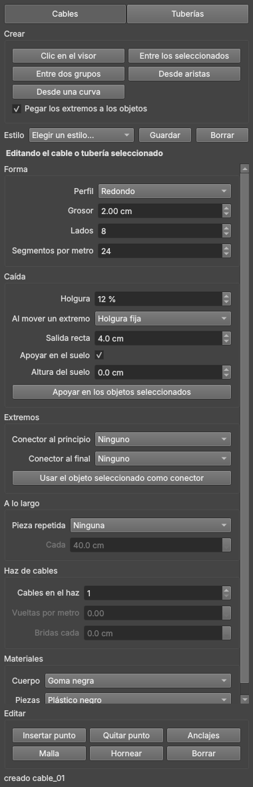

# PipeEditor

**Cables que cuelgan y tuberías con codos y accesorios para Autodesk Maya 2026 y 2027** (Mac y Windows), con materiales listos para Arnold. El reposo físico usa numpy, que viene con Maya 2026 y 2027. Interfaz en español, preparada para traducirse. Licencia MIT.

*English summary: PipeEditor is a free Maya 2026/2027 plug-in for hanging cables (true catenary, live anchors, connectors, bundles, rope, hose and coiled profiles) and orthogonal pipes (elbows, flanges, wall supports, square ducts, flexible and insulated pipes). Everything stays live until you bake it into plain Maya meshes. Install by dragging `instalar.py` into the Maya viewport.*



## Instalar

1. Descarga el repositorio (botón verde **Code → Download ZIP**) y descomprímelo donde quieras dejarlo.
2. Abre Maya y **arrastra `instalar.py` al visor**.
3. Aparece el menú **PipeEditor** en la barra de Maya. Se carga solo cada vez que abres Maya.

Para desinstalar, borra `pipeeditor.mod` de la carpeta `modules` de tus preferencias de Maya (la ruta sale en el Script Editor al instalar). No muevas la carpeta después de instalar; si lo haces, vuelve a arrastrar `instalar.py`.

## Qué hace

### Cables
- **Caída real**: catenaria exacta entre cada par de puntos, al instante aunque haya muchos cables.
- **Reposo físico**: si toca el suelo o un objeto de apoyo, el cable se asienta: se tumba en el suelo con curvas amplias, no atraviesa mesas ni postes y cae por los bordes. Con *Rigidez*, *Ondulación* y *Semilla*.
- **Ganchos**: puntos por los que el cable pasa deslizando, sin atarse.
- **Dos modos de tensión**: *holgura fija* (siempre cuelga en proporción; para decorar escenas) y *longitud fija* (guarda la longitud y se tensa al separar los extremos; para animar).
- **Salida recta**: el cable sale perpendicular a la superficie antes de colgar, como de un enchufe.
- **Conectores** en cada extremo: clavija, jack, terminal, gancho, grillete, aislador, rollo o cualquier objeto tuyo.
- **Perfiles**: redondo, doble (cable de lámpara en ocho), plano (cinta), trenzado (cuerda de tres cabos), corrugado (manguera), espiral (teléfono) y cadena.
- **Viento**: balanceo animado de los cables que cuelgan, con ráfagas y dirección.
- **Un cable encima de otro**: cualquier cable puede ser apoyo de otro.
- **Guirnaldas de luces** con bombillas que iluminan en Arnold, y **rollos** del cable que sobra.
- **Haz de cables**: varios cables juntos, retorcidos y con bridas de plástico, o sueltos (sin bridas), cada uno colgando por su cuenta sin atravesar a los demás.
- **Piezas a lo largo**: bridas, anillos o etiquetas cada cierta distancia.
- **Entre dos grupos**: muchos cables de golpe entre las caras de dos objetos, con holgura y grosor algo distintos.
- **Puntos intermedios**: insertar o quitar anclajes; cada tramo tiene su propia holgura (atributo *Holgura de este tramo* del anclaje).

### Tuberías
- **Trazado en ángulo recto**: junto a las superficies (de la pared al suelo baja por la pared y sigue por el suelo), esquivando objetos por su forma real sin separarse de la pared, en Z, en L o en línea recta.
- **Medidas normalizadas** de acero (DN y ANSI), cobre (EN 1057), PVC y multicapa.
- **Varias en paralelo** (rack), apiladas a lo largo de la pared.
- **Desde aristas o curvas**: sigue el borde de un modelo o una curva, y se actualiza si los editas.
- **Codos** curvados (radio largo de 1,5 diámetros por defecto), con pieza de unión o soldados con cordón.
- **Bridas** repartidas en los tramos rectos y a los dos lados de cada codo.
- **Soportes a la pared**: abrazadera, varilla y placa hasta la superficie más cercana, a la separación que toca por el diámetro.
- **Perfiles**: redonda, cuadrada (conducto), corrugada (flexible), aislada y bandeja portacables. Pared visible en los extremos abiertos; también tapón o brida.
- **Accesorios**: válvulas de bola y de compuerta, tes con derivación y reducciones en cualquier anclaje.
- **Pendiente** para desagües, **soportes** a la pared, colgados del techo o apoyados en el suelo, y **señales** (flechas de sentido y bandas de color).
- **Más normas**: PVC a presión y de desagüe, multicapa y acero ANSI.
- **Lista de materiales** en CSV para una hoja de cálculo.

### Para los dos
- Todo sigue **vivo**: los extremos son localizadores amarillos; muévelos, anímalos o mueve el objeto al que están pegados y el cable se recalcula.
- La ventana edita lo seleccionado al momento. También hay una pestaña en el **Editor de atributos**.
- **Mis estilos**: guarda combinaciones de ajustes. Vienen doce de serie (cable de lámpara, tendido eléctrico, cuerda de puerto, manguera, mazo de cables, teléfono antiguo, guirnalda de luces, cadena, fontanería de cobre, tubería industrial, conducto de ventilación, tubo flexible).
- **Materiales** para Arnold (OpenPBR en Maya 2026 y 2027): goma, PVC, nailon, cáñamo, cobre, acero, galvanizado, óxido, hierro pintado, aluminio, latón y luz cálida (bombillas)...
- **Mallas limpias**: cerradas, con aristas duras y pliegue para subdividir; el metal va en su propia malla y material.
- **UV a escala real** (1 unidad = 10 cm): una textura tileable se repite igual en todos los cables.
- **Asentar y fijar**: guarda la forma de un cable y deja de calcularla (escenas grandes, animación de otros objetos). Si mueves un extremo, la forma se estira hasta él.
- **Hornear**: convierte en mallas normales de Maya. Al guardar, PipeEditor avisa si quedan cables vivos, porque una escena con cables vivos necesita PipeEditor para abrirse bien.
- **Render como curva** de Arnold para escenas con cientos de cables.
- **Exportar horneado** a USD, FBX u OBJ sin tocar la escena.
- **Copia horneada para render**: guarda una copia con todo horneado para una granja u otro ordenador sin PipeEditor, sin tocar la escena abierta.

## Formas de crear

| Forma | Cómo |
| --- | --- |
| Clic en el visor | Cada clic sobre una superficie añade un punto. Ctrl+clic empieza otro. Ctrl+Z quita el último. Q (herramienta de selección) termina. |
| Entre los seleccionados | Objetos, vértices, caras o localizadores, en el orden de selección. |
| Entre dos grupos (cables) | Caras o vértices de dos objetos: un cable por pareja. |
| Desde aristas | Una fila de aristas seguidas de un modelo. |
| Desde una curva | Una o varias curvas NURBS. |

En el menú **PipeEditor** también están: hornear, guardar una copia horneada, la lista de materiales (CSV), exportar horneado (USD, FBX u OBJ) y el idioma.

Las mismas órdenes están en **Windows → Settings/Preferences → Hotkey Editor → Custom Scripts → PipeEditor** para ponerles un atajo.

## Pruebas

- Sin Maya: `python -m unittest discover -s tests` (necesita numpy; la ventana se prueba si hay PySide6).
- Con Maya: `mayapy herramientas/prueba_maya.py` crea cables y tuberías de todos los tipos, los mueve, los guarda, los abre y los hornea, y mide la calidad (longitud, contactos, mallas cerradas, tiempos). Termina con `RESULTADO: OK`.
- `mayapy herramientas/render_referencia.py carpeta nombre` renderiza la misma escena con Arnold para comparar versiones.

Los cambios de cada versión están en [CHANGELOG.md](CHANGELOG.md).

## Estructura

```
instalar.py                      arrástralo al visor de Maya
plug-ins/pipeeditor_plugin.py    registra el nodo y el menú
scripts/pipeeditor/
  catenaria.py  trazado.py  apoyo.py      matemática (sin Maya)
  reposo.py                               reposo físico (numpy)
  lista_materiales.py                     lista de materiales en CSV (sin Maya)
  malla.py  perfiles.py  piezas.py        mallas (sin Maya)
  construir.py                            de ajustes a malla (sin Maya)
  nodo.py                                 nodo pipeEditorNodo (en vivo)
  escena.py  materiales.py                crear, editar y hornear en la escena
  ventana.py  interfaz_maya.py            ventana, menú y órdenes
  estilos.py  i18n/es.json                estilos y textos
scripts/AEpipeEditorNodoTemplate.mel      pestaña del Editor de atributos
```

## Traducir

Viene en español e inglés: **PipeEditor → Idioma**. Los textos están en `scripts/pipeeditor/i18n/` (`es.json`, `en.json`). Para otro idioma, copia `es.json` con el código del idioma (por ejemplo `fr.json`) y tradúcelo: aparece solo en el menú. La variable de entorno `PIPEEDITOR_IDIOMA` manda sobre el menú.

## Licencia

MIT. Copyright (c) 2026 Adrián Mantilla Pousa.
